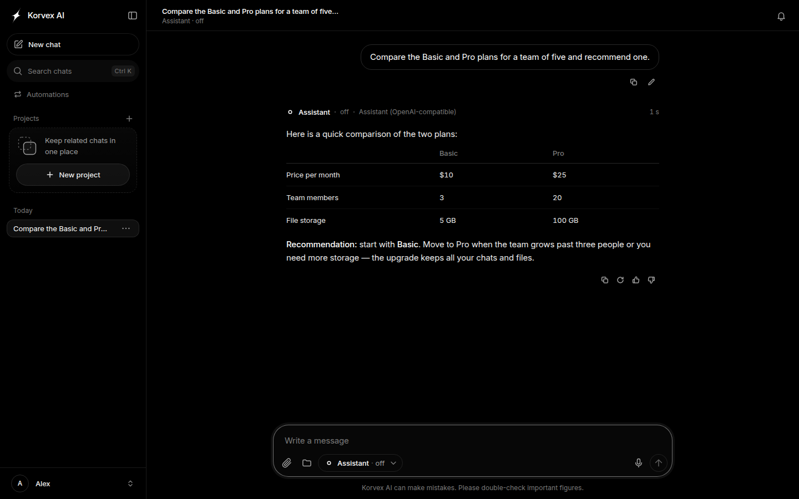

# Korvex AI Chat

A self-hosted chat for any OpenAI-compatible model: background answers that survive a closed tab, chat folders and search,
file reading and preview, user memory, automations, voice input, Web Push and an admin panel with users, invites and limits.

> © 2026 Korvex · Apache-2.0



## Quick start

```bash
git clone https://github.com/YourLast/Korvex-AI-Chat.git
cd Korvex-AI-Chat
npm ci
cp .env.example .env.local
npm run build && npm start
```

Open http://localhost:3000. The first account you create becomes the admin; after that, sign-up is closed
(invite people from the admin panel, or turn sign-up on in **Admin → Features**).

Requirements: Node.js 22 and a model server. In production, run it behind HTTPS and set `COOKIE_SECURE=1`.

Settings are environment variables — see [.env.example](.env.example). How it works — [docs/ARCHITECTURE.md](docs/ARCHITECTURE.md).

## Deploy

- **Your server:** `docker compose up -d` — the app and a speech-to-text server, voice input works out of the box.
- **Cloud:** [](https://render.com/deploy?repo=https://github.com/YourLast/Korvex-AI-Chat)
  · Railway and Fly.io — a few steps in [docs/DEPLOY.md](docs/DEPLOY.md).
- **Vercel** is not supported yet: long answers, background jobs and SQLite need a long-running server —
  see [why, and what it would take](docs/DEPLOY.md#why-not-vercel-yet).

## Models

Add models in **Admin → Models**: pick a provider — any OpenAI-compatible server, OpenAI, Anthropic, OpenRouter, Ollama or
LM Studio — enter the address and the API key, press **Check connection**, then add the models you want people to use.
API keys are stored encrypted (AES-256-GCM, the key file is `data/keys/korvex.key`) and are never shown again.

You can also list models in `models.config.json` (see `models.config.example.json`); `apiKeyEnv` names the environment
variable with the key.

## Admin panel

- **People** — invites (single and group links), roles, blocking, limits, activity.
- **Models** — providers and models.
- **Features** — turn off voice input, files, user memory, automations, web search, model comparison, notifications or
  sign-up for everyone. Code mode (an agent that runs commands in a sandbox) is off by default: turn it on only on an
  isolated machine.
- **Access** — who can use each model or feature: by role, by person, or everyone who joined through an invite link.
- **Brand** — your product name instead of “Korvex” in every text and in how the model introduces itself, your logo,
  accent color and the line at the bottom of the sign-in page. The [NOTICE](NOTICE) file stays as it is.

## Current limits

- Voice input needs a speech-to-text server with an OpenAI-compatible `/v1/audio/transcriptions` (set `STT_URL`).
- Previews of Office documents need a Docker image with LibreOffice; PDF, spreadsheets and text open without it.
- Web search needs a SearXNG address (`KX_SEARX_URL`).
- No Vercel version yet — see [docs/DEPLOY.md](docs/DEPLOY.md#why-not-vercel-yet).

## License

Apache License 2.0 — see [LICENSE](LICENSE) and [NOTICE](NOTICE). The Korvex name and logo are trademarks of Korvex;
the license does not grant permission to use them beyond what is needed to describe the origin of the software.
